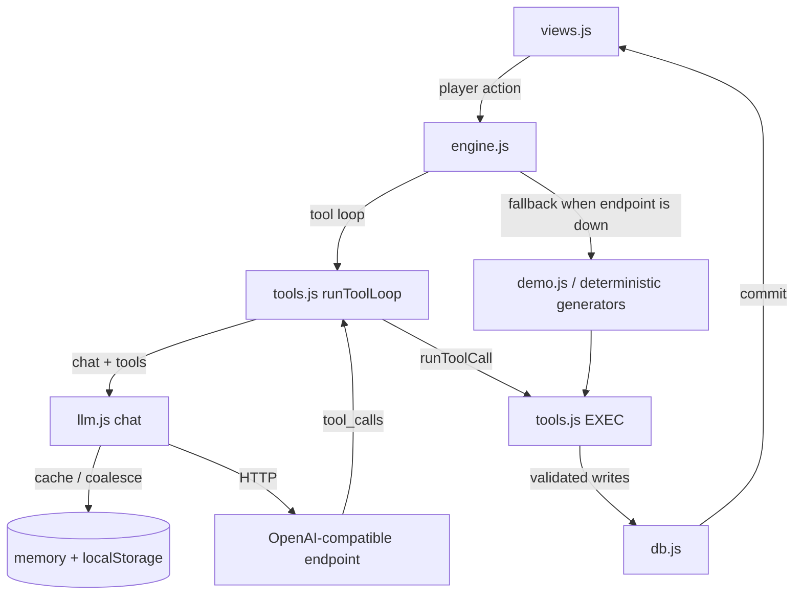

# Architecture notes

## Call graph



## Why tools instead of JSON blobs

A model asked to return `{"posts": [...], "dms": [...]}` will occasionally
return malformed JSON, invent fields, reference characters that don't exist, or
exceed a token budget mid-object. Every one of those failures requires repair
logic on the client.

Tools invert this. The model emits small, independently-validated calls. A bad
call is rejected in isolation and reported back; the rest of the batch still
applies. It also lets the model stop early when it has nothing to add, instead of
padding a schema to satisfy a forced structure.

## Call optimisation layers

| Layer | Where | Effect |
|---|---|---|
| Response cache | `llm.js` `cacheGet`/`cacheSet` | Identical prompt within TTL → zero HTTP |
| In-flight coalescing | `llm.js` `inflight` | Concurrent identical → one HTTP |
| Tiered models | `config.js` `cheapModel`/`fastModel` | Cheap model for filler work |
| Batched events | `engine.js` `runAutonomyTick` | N events per call, not N calls |
| Local-first routing | `tools.js` `routeIntent` | Simple intents skip HTTP entirely |
| History compaction | `engine.js` `summariseThread` | Bounded prompt growth |
| Tool dedupe | `tools.js` `runToolLoop` | Repeated calls discarded |
| Round cap | `tools.js` `maxRounds` | Bounded tool round-trips |

Failures fall through to the local generator, so the world is always playable.

## Tool contract

Each executor returns:

```js
{ ok: boolean, summary: string, data?: object }
```

`summary` goes back to the model as the tool result, so it must be short and
human-readable. It is also what appears in the Activity log, which means the log
doubles as an audit trail of what the model actually did.

Validation rules:

- Authors must exist in the roster, or be `player`.
- Text is length-clamped, never trusted.
- Numeric deltas are clamped to safe ranges.
- Unknown tools and malformed JSON return `ok: false` instead of throwing.

## State shape

```
player   identity + followers
stats    energy, mood, clout, money, streak
npcs     roster with archetype, affinity, followers
posts    feed, each with replies[]
threads  DM threads, each with messages[] and optional summary
events   world headlines
log      tool/LLM audit trail
flags    free-form narrative memory
```

Persisted as one JSON blob under `status.save.v1`. Migrations bump
`SCHEMA_VERSION` in `db.js`.

## Adding a tool

1. Add a definition to `TOOL_DEFS` in `js/tools.js` — name, description, JSON schema.
2. Add a matching executor to `EXEC` that returns `{ ok, summary }`.
3. That's it. Both the LLM path and the local path pick it up automatically.

Keep the description terse: it is charged as input tokens on every request that
includes the tool set. If a tool is only needed for one feature, filter `TOOLS`
at the call site (see `reactToPlayerPost` for an example).

## Adding a view

1. Write `renderX(ctx)` in `js/views.js` returning a `view-inner` element.
2. Add it to the `TABS` array and the dispatch in `render()` in `js/app.js`.
3. Use `ctx.refresh()` to re-render and `ctx.toast()` for feedback.

## Degraded behaviour

`demo.js` returns real chat-completion objects, including `tool_calls`, so the
fallback path is not a separate code path — it is a fake endpoint. This means
bugs in the tool loop surface even when the real endpoint is unavailable, which
is the point.

The fallback is used when the endpoint fails or no key is configured. Normal
play always goes through the model.
